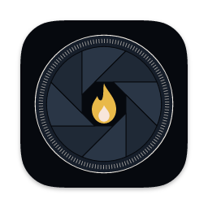

# Vigil

Vigil is a macOS menu bar app that keeps your Mac awake while local coding agents work. It releases its idle-sleep assertion when the work stops, fails, or waits for your input longer than a grace period.

**Download:** [vigilmac.com/download](https://vigilmac.com/download) · **Site:** [vigilmac.com](https://vigilmac.com) · **Privacy:** [vigilmac.com/privacy](https://vigilmac.com/privacy)

This repository is the public home for Vigil's releases, bug reports, and feature requests. The source code is not here.

- **Releases** hold the signed and notarized `Vigil.dmg` and the notes for each version.
- **`appcast.xml`** is the update feed that the app reads, served by GitHub Pages at `https://latent-signal.github.io/vigil-releases/appcast.xml`. It lists no release until the first one ships.
- **Issues** take bug reports and feature requests.

## Before you open an issue

Issues are public. Anyone can read what you paste.

Vigil sees what your coding agents do. Do not paste prompts, agent output, file or folder paths, project names, session IDs, or anything else from your agent sessions into an issue unless you have checked it and are willing to make it public.

This matters most for the developer log. When `Capture raw hook payloads` is on in Settings > Advanced, the log keeps the full hook payload with no redaction. That can include prompt text, assistant messages, tool arguments and output, transcript paths, and, for Cursor, your email address. Paste only the lines that show the problem, and replace any private value with a placeholder such as `<path>`.

Search the existing issues first. Use the bug report template for a problem and the feature request template for an idea.

## Requirements

macOS 14 or later.
